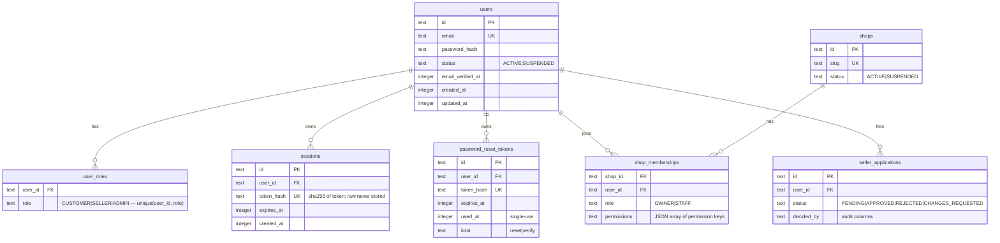

# Data Model

**Status: Partially implemented** — identity, sellers, and settings tables exist
(`drizzle/0000_*.sql`, `0001_*.sql`); catalog/cart/orders/payments/etc. are
Planned per the roadmap.

## Conventions

- **IDs:** `text` ULIDs (seed uses fixed readable ids like `usr_admin` for
  determinism).
- **Timestamps:** `integer` unixepoch UTC, `_at` suffix, seconds convention
  going forward (Phase-2 session/token expiry fields currently store ms — see
  known limitations).
- **Money (planned):** `integer` whole đồng, `_vnd` suffix.
- FKs are explicit; `PRAGMA foreign_keys=ON` and `journal_mode=WAL` set in
  `src/server/db/client.ts`.

## Implemented tables

`application_settings` is a keyed JSON table (seeded: `commission_rate_bps`,
`return_window_days`, `auto_complete_days`, `currency`, `reservation_ttl_minutes`).

## Planned entity groups

Per design spec §3: profiles/addresses, catalog (categories, brands, products,
variants, images, moderations), inventory + movements + stock_reservations,
carts/wishlists, promotions/vouchers/redemptions, orders → seller_orders →
order_items + pricing breakdowns, payments/attempts/refunds, shipments/tracking,
returns, reviews, notifications, financial_ledger_entries + seller_settlements,
audit_logs, idempotency_records.

## Migrations

`make db-generate` (drizzle-kit) → `make db-migrate` → `make db-seed`.
Deterministic, idempotent seed (`onConflictDoNothing`, fixed seed timestamp).
