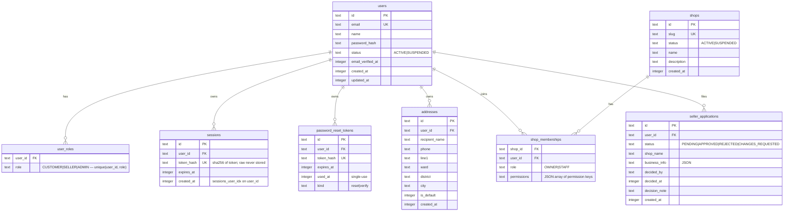
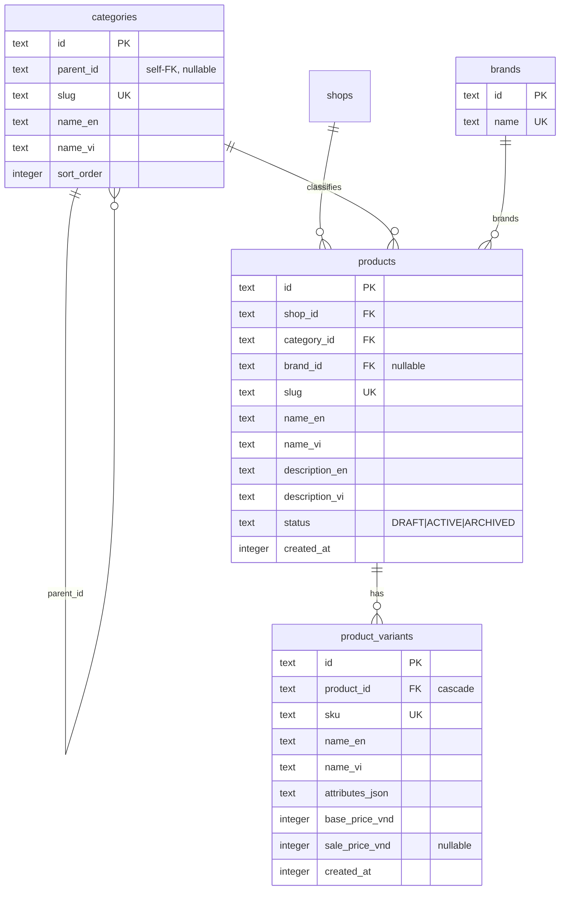
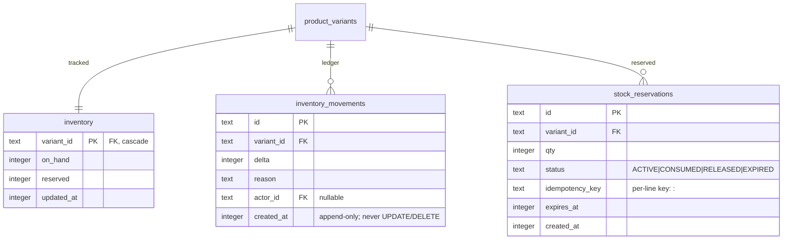
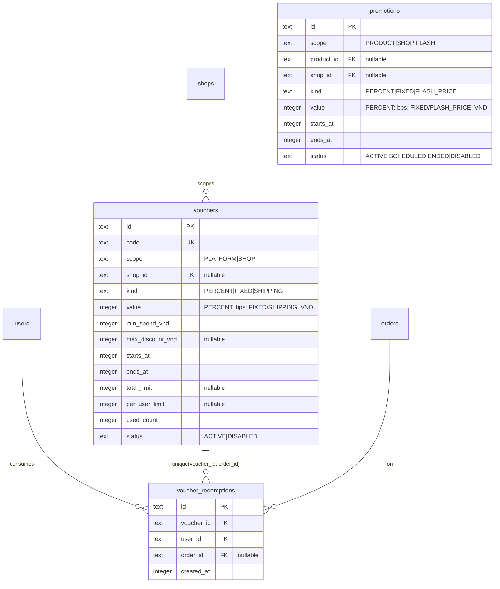
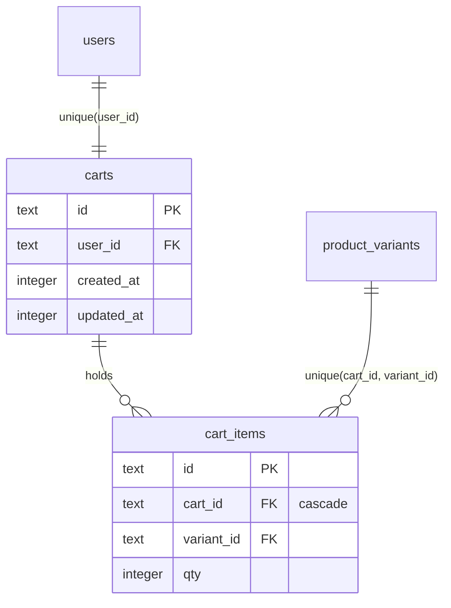
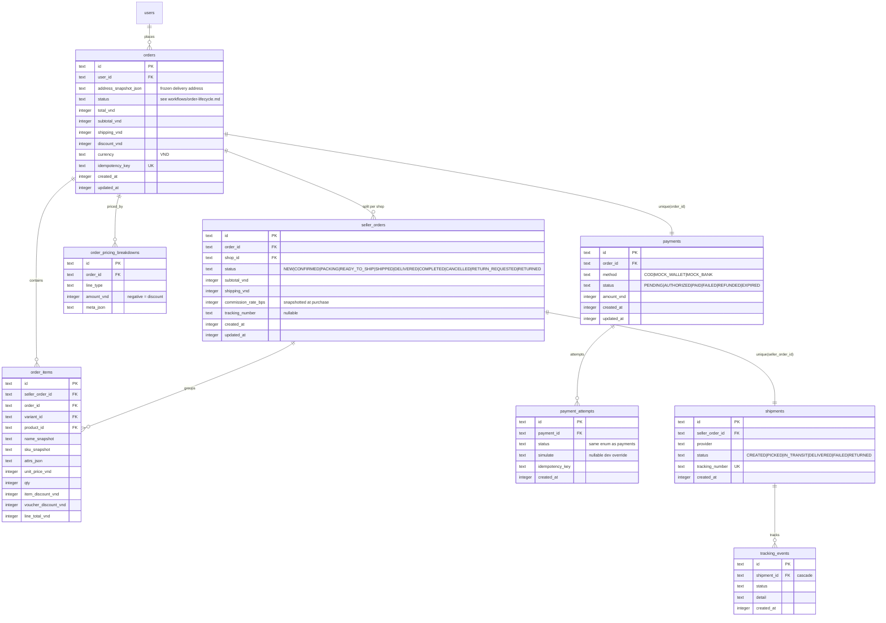
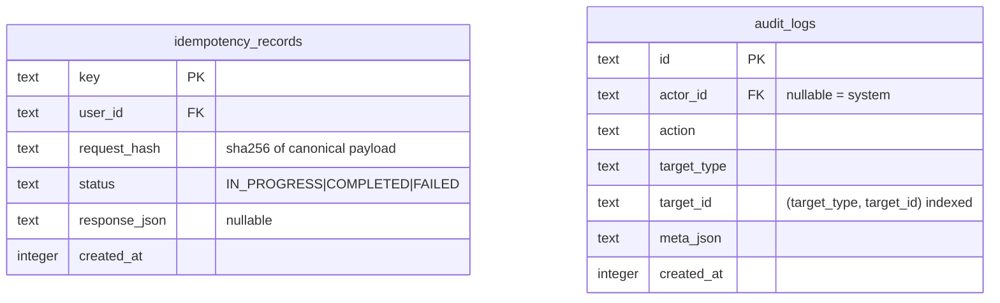

# Data Model

**Status: Partially implemented** — identity, sellers, settings, addresses,
catalog, inventory, pricing, cart, orders/payments/shipments, idempotency and
audit tables exist (`drizzle/0000_*.sql` … `0004_*.sql`). Remaining groups
(returns, reviews, notifications, ledger/settlements, wishlists) are Planned
per the roadmap.

## Conventions

- **IDs:** `text` ULIDs with a type prefix (`ord_`, `so_`, `pay_`…); seed uses
  fixed readable ids like `usr_admin` for determinism.
- **Timestamps:** `integer` unixepoch **milliseconds** UTC, `_at` suffix
  (`Date.now()`-native throughout, seed included).
- **Money:** `integer` whole đồng, `_vnd` suffix.
- **Snapshots:** denormalized `*_snapshot`/`attrs_json` columns freeze
  address/product/variant data onto order rows at purchase time.
- FKs are explicit; `PRAGMA foreign_keys=ON` and `journal_mode=WAL` set in
  `src/server/db/client.ts`.

## Identity, sellers, settings

`application_settings` is a keyed JSON table (seeded: `commission_rate_bps`,
`return_window_days`, `auto_complete_days`, `currency`,
`reservation_ttl_minutes`, `shipping_fees`).

## Catalog

## Inventory

## Pricing

## Cart

## Orders, payments, shipments

## Idempotency and audit

## Planned entity groups

Per design spec §3: returns, reviews, notifications, financial_ledger_entries
+ seller_settlements, wishlists, product images/moderations, search indexes.

## Migrations

`make db-generate` (drizzle-kit) → `make db-migrate` → `make db-seed`.
Deterministic, idempotent seed (`onConflictDoNothing`, fixed seed timestamp);
e2e runs `scripts/db-seed.ts` against `tests/.tmp/e2e.db`.
