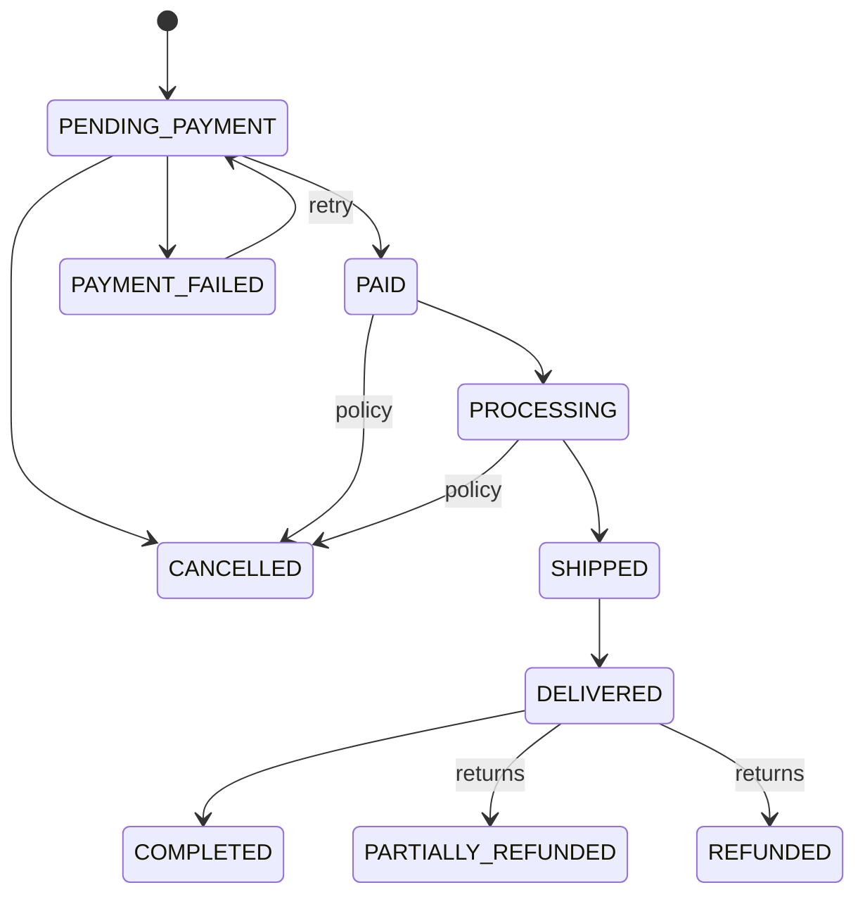

# Order Lifecycle

**Status: Planned** — orders are not yet implemented. This document will describe
the implemented state machines once Phase 5 lands. Design intent (design spec §5):

Seller-order fulfillment runs its own machine: `NEW → CONFIRMED → PACKING →
READY_TO_SHIP → SHIPPED → DELIVERED → COMPLETED`, with `NEW|CONFIRMED →
CANCELLED` and `DELIVERED → RETURN_REQUESTED → RETURNED|COMPLETED`.

Transitions will be lookup tables in `src/server/modules/orders/transitions.ts`
enforced by `transitionOrder`/`transitionSellerOrder`, each writing an
`audit_logs` row. Delivered orders auto-complete after
`application_settings.auto_complete_days` (seeded: 3) via an env-token-guarded
internal endpoint.
