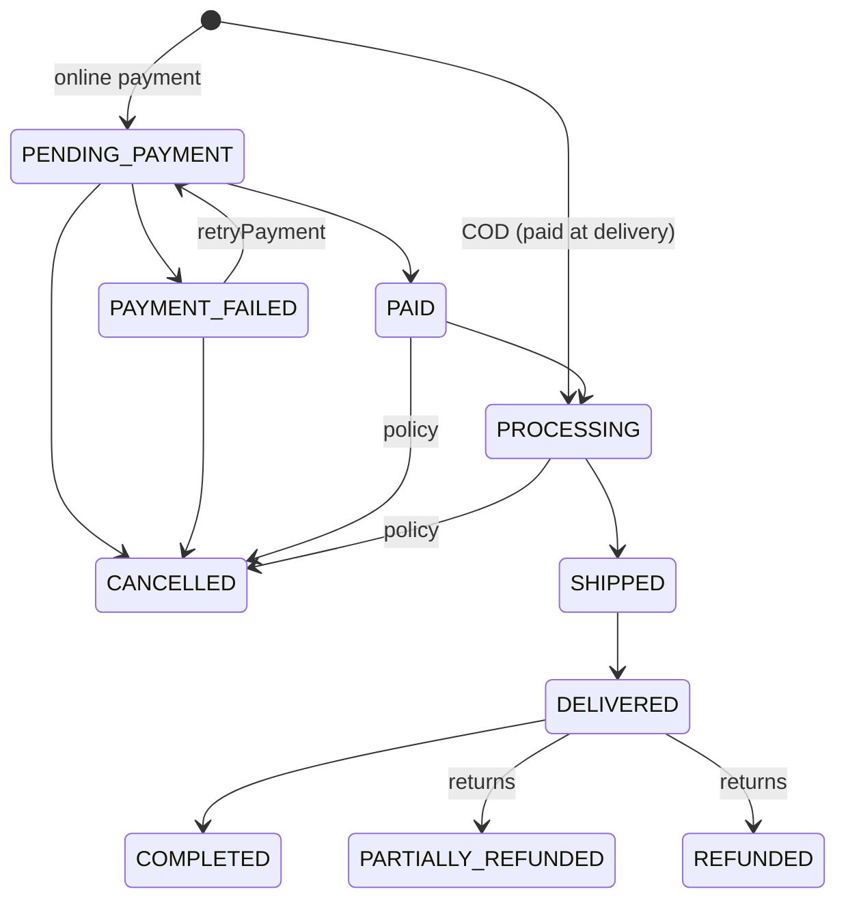
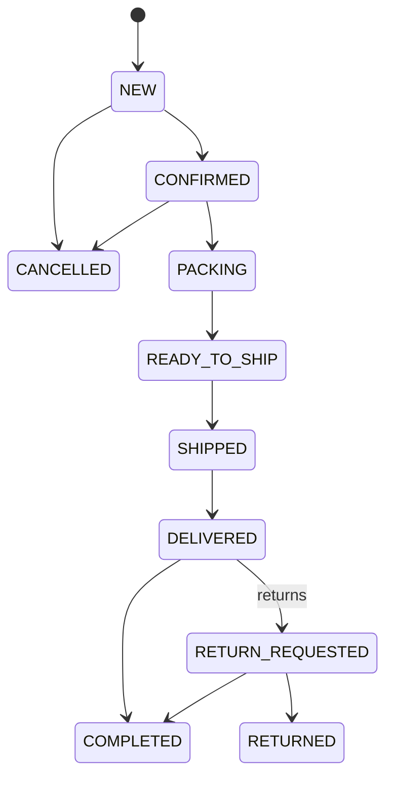

# Order Lifecycle

**Status: Implemented** — transition tables and enforcement live in
`src/server/modules/orders/transitions.ts`; writes happen in
`src/server/modules/orders/checkout.ts` and `service.ts`. Every transition
writes an `audit_logs` row.

## Parent order

`COD` orders skip `PENDING_PAYMENT` — the payment attempt stays `PENDING`
until collection. Mock-wallet orders dispatch synchronously after the commit
(`dispatchWalletPayment`): success → `PAID`, failure → `PAYMENT_FAILED` with
reserved stock still held for `retryPayment` (or released by `cancelOrder`).

## Seller order (fulfillment)

Forward seller-order moves (`CONFIRMED` … `COMPLETED`) are blocked while the
parent order is unpaid or dead — `PAID_PARENT` gates fulfillment so partners
can't progress a `PENDING_PAYMENT`/`PAYMENT_FAILED`/`CANCELLED` order. Cancel
and returns are exempt so owner-cancel always works.

## Enforcement

`ORDER_TRANSITIONS` / `SELLER_ORDER_TRANSITIONS` lookup tables back
`transitionOrder` / `transitionSellerOrder`. Same-status calls are idempotent
no-ops; illegal moves throw `INVALID_INPUT` 422. Non-system actors must be
ADMIN, the order owner (parent transitions), or a shop member with
`order:write` (seller-order transitions — the parent owner may also cancel).
`actor: null` marks system transitions (payment dispatch, sweeps).
