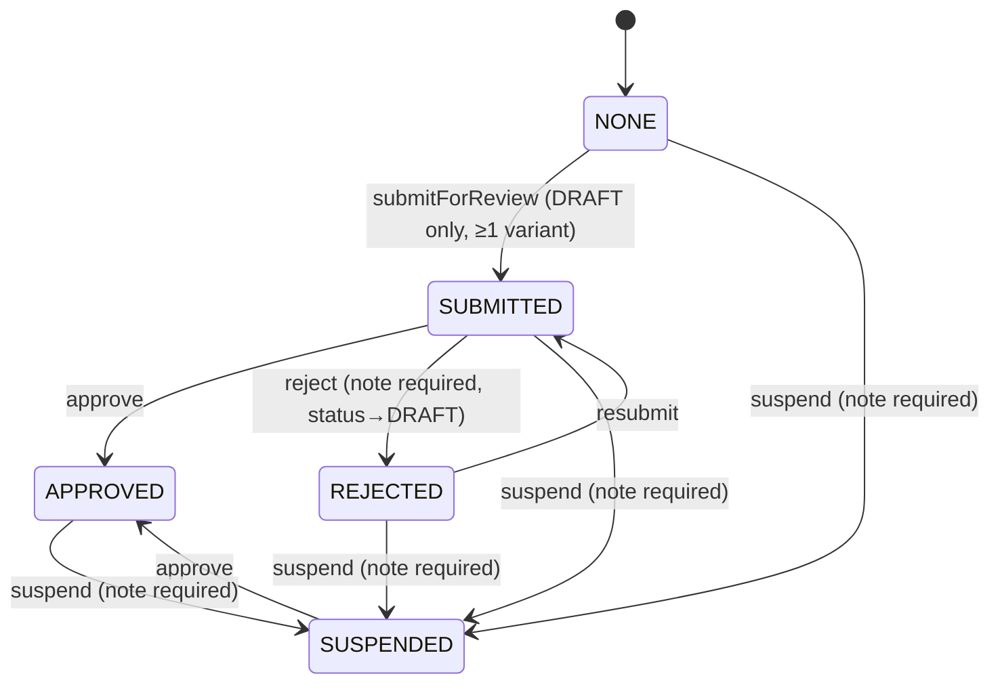

# Product Moderation

**Status: Implemented** — transitions live in
`src/server/modules/catalog/moderation.ts`; every submission and decision
writes an append-only `product_moderations` row.

Two orthogonal columns:

- `products.status` (`DRAFT|ACTIVE|ARCHIVED`) — the seller-facing lifecycle;
  sellers move it via publish/unpublish/archive.
- `products.moderation_status` (`NONE|SUBMITTED|APPROVED|REJECTED|SUSPENDED`,
  default `NONE`) — the admin gate.

Public reads require `status='ACTIVE'` AND `moderation_status IN
(NONE,APPROVED)` (encoded once as `publicGate` in `catalog/service.ts`,
applied to list/detail/search/suggest/homepage/cart sellability). `NONE`
stays visible: seeded and pre-moderation products never entered review, and a
`NONE` draft may still be published directly by its seller. Once a product
touches the pipeline it is hidden until an admin approves it.

## Admin gate

- `submitForReview` — seller (`product:write` on the shop); `DRAFT` +
  `NONE|REJECTED` → `SUBMITTED`; reuses `assertPublishable`.
- `moderateProduct` — `admin:*` only. `approve` flips moderation_status only
  (a submitted draft stays `DRAFT` until the seller publishes it — approve
  never overrides the seller-facing status). `reject` requires a note and
  resets status to `DRAFT`. `suspend` requires a note, keeps seller status,
  and the public gate hides the product regardless.
- Admin queue: `/admin/moderation` lists `SUBMITTED` oldest-first with an
  inline note field; decision history is per-product via
  `listProductModerations`.

Seller UI: `/seller/products` shows moderation badges and a "Submit for
review" action on `DRAFT` + `NONE|REJECTED` rows.
